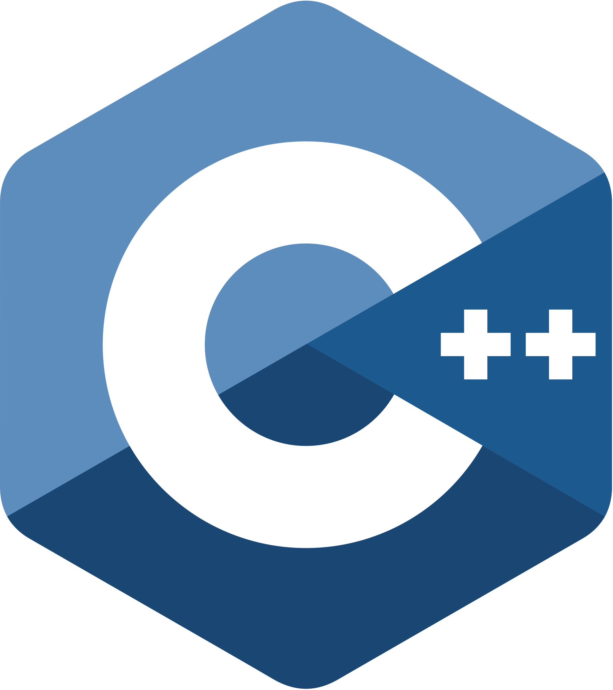
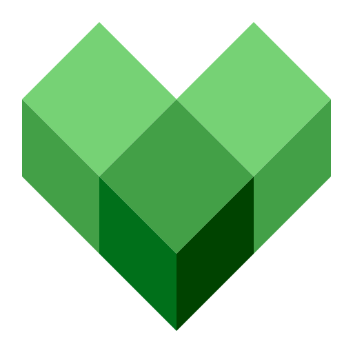

<h1 align="left" id="title">👋 Hello there! I'm Julien DELCLOS</h1>

<h3 align="left">Senior Computer Vision Engineer &mdash; real-time perception on NVIDIA edge (C++ · CUDA · TensorRT), 3D vision. French (EU citizen)</h3>

<h2 align="left" id="work">🧭 Selected work</h2>

- **[panoptic-prelabel]** &mdash; semi-automatic panoptic annotation (Mask R-CNN + MobileSAM, CVAT,
  deterministic COCO-panoptic resolve). On a T4, Mask R-CNN runs in 107&nbsp;ms with CUDA and
  **46&nbsp;ms with TensorRT FP16**. Its masks drive the carousel on [juliendelclos.com][my portfolio website] ([site code][portfolio-code]).
- **ZED SDK** &mdash; co-maintained Stereolabs' public [zed-sdk] and [zed-python-api] repositories and published
  12 releases (5.0.3 → 5.3.0, 2025–2026), the later ones as Lead Software Engineer.
- **[ShowTracker]** &mdash; my TV-series tracker: Android, iOS and web from one codebase.

The full story, with pictures: **[juliendelclos.com][my portfolio website]**.

<h2 align="left" id="background">🧳 Background</h2>

- **[DroneShield]** (Sydney, 2026) &mdash; Senior Computer Vision Engineer.
- **[Stereolabs]** (Paris, 2024–2026) &mdash; ZED SDK: real-time detection + segmentation network deployed with
  TensorRT/CUDA on Jetson, then Lead Software Engineer coordinating ~20 engineers across 5 teams.
- **[Zenseact]** (Göteborg, 2022–2024) &mdash; 3D lane detection for ADAS (Volvo, Polestar): multi-task network,
  real-time C++/CUDA post-processing, quantized TensorRT deployment, safety-critical C++.
- **Bosch** via Technology & Strategy (Stuttgart area, 2019–2022) &mdash; technical lead on embedded perception:
  quantized networks on NXP i.MX6 / i.MX8, a GStreamer video pipeline, auto-annotation.

<h2 align="left" id="tech">🛠️ Tech</h2>

<table>
  <tr>
    <td align="center" width="96">
      
       C++
    </td>
    <td align="center" width="96">
      
       Python
    </td>
    <td align="center" width="96">
      
       CUDA
    </td>
    <td align="center" width="96">
      
       TensorRT
    </td>
    <td align="center" width="96">
      
       GStreamer
    </td>
    <td align="center" width="96">
      
       OpenCV
    </td>
  </tr>
  <tr>
    <td align="center" width="96">
      
       PyTorch
    </td>
    <td align="center" width="96">
      
       Linux
    </td>
    <td align="center" width="96">
      
       Docker
    </td>
    <td align="center" width="96">
      
       Git
    </td>
    <td align="center" width="96">
      
       Bazel
    </td>
    <td align="center" width="96">
      
       VSCode
    </td>
  </tr>
</table>

<h2 align="left" id="contact">📫 Contact</h2>

**[LinkedIn]** · **[julien.delclos@gmail.com](mailto:julien.delclos@gmail.com)** · **[juliendelclos.com][my portfolio website]**

 

<h2 align="left" id="about-me">😀 About me</h2>

- 💬 &nbsp;I like to talk about **Chess**, **Climbing**, **Motorbikes**, **Animes**, **TV Shows** (enough to build [a tracker for them][ShowTracker]), **Deep Learning**, **C++** and **RegEx**
- ♟️ &nbsp;Come and play with me on **[Lichess.org]** or **[Chess.com]**
- 👀 &nbsp;Follow my *Coding Puzzles* and *Challenges* activities on **[CodinGame]**, **[LeetCode]** and **[HackerRank]**
- 🙈 &nbsp;Check out my **[Gists]**
- 🎓 &nbsp;Engineering degree (MSc) from **[Telecom SudParis]**
- ✈️ &nbsp;I worked in Paris-Saclay (CEA-List 🇫🇷), Turin (Cedeo.net 🇮🇹), Stuttgart (Bosch/TnS 🇩🇪), Göteborg ([Zenseact] 🇸🇪), Paris ([Stereolabs] 🇫🇷) and Sydney ([DroneShield] 🇦🇺, 2026)

<h2 align="left" id="certifications">🎓 Certifications</h2>

  
Deep learning, OpenCV and competitive-programming certificates

- Coursera - DeepLearning.ai
  1. <a href="https://www.coursera.org/account/accomplishments/certificate/97PU3C7NJSLQ">Neural Networks and Deep Learning</a>
  2. <a href="https://www.coursera.org/account/accomplishments/certificate/HB476JH9JZ3U">Improving Deep Neural Networks: Hyper parameter tuning, Regularization and Optimization</a>
  3. <a href="https://www.coursera.org/account/accomplishments/certificate/NQQDK87X6BCS">Structuring Machine Learning Projects</a>
  4. <a href="https://www.coursera.org/account/accomplishments/certificate/DBY2EGX7DJV7">Convolutional Neural Networks</a>
- OpenCV
  1. Fundamentals of Computer Vision & Image Processing (<a href="https://courses.opencv.org/certificates/5a617344365141218a30908e3d70c107">Python</a> / <a href="https://courses.opencv.org/certificates/8bfc73916051470db419b58473e7e326">C++</a>)
  2. Computer Vision & Deep Learning applications (<a href="https://courses.opencv.org/certificates/0220f408aa7b4f108fa6caeadd67b68f">Python</a> / <a href="https://courses.opencv.org/certificates/95fed3c0196848ff8f87d5e6b2c70636">C++</a>)
  3. <a href="https://courses.opencv.org/certificates/0868f504ce7c45efad23a19e687e7c80">Deep Learning with PyTorch</a>
- From competitive programming site
  1. <a href="https://www.codingame.com/profile/b944cb66159c494961db183c595578915353933">Codingame</a>
      - Coding languages: <a href="https://www.codingame.com/certification/X8xmLlqhxdHe3qdbnptA_g">C++</a> / <a href="https://www.codingame.com/certification/q9mJg_dSwGGxIJZBWvcbGg">Python3</a> / <a href="https://www.codingame.com/certification/tFez46KsEVzwtDTxwC2rnw">C#</a>
      - Skills: <a href="https://www.codingame.com/certification/N71wYOEU8FSc_hW_gRkXHg">Algorithms</a> (Legend) / <a href="https://www.codingame.com/certification/m1c7kan5egvyqip-e-q3GA">Coding speed</a> (Legend) / <a href="https://www.codingame.com/certification/Dyg9qJRO29IOgzgYiTsrAw"> Collaboration</a> (Legend) / <a href="https://www.codingame.com/certification/pJeTtRt-zORbUNyu-LYPkw">Optimization</a> (Legend) / <a href="https://www.codingame.com/certification/viDaIEcw1Qv7s-7QNfZoZQ">Artificial Intelligence</a> (Legend)
  2. <a href="https://www.hackerrank.com/julien_delclos">HackerRank</a>
      - Problem Solving (<a href="https://www.hackerrank.com/certificates/baec44ae8e68">Basic</a> / <a href="https://www.hackerrank.com/certificates/b420d1c21061">Intermediate</a>)
      - Python (<a href="https://www.hackerrank.com/certificates/0b21a0a1990d">Basic</a>)

<h2 align="left" id="leetcode">👨‍💻 LeetCode</h2>

> If I'm not lazy, I do at least the daily puzzle.

<h2 align="left" id="chess">♟️ My Chess games (Chess.com) </h2>

> If you are in dark mode, you might not see the figures' title
>
> You can see here:
>   - The daily game I'm currently playing (vercel [link](https://chesscom-vercel-jujudel.vercel.app/chess-current-games/?username=LuckyJujuD))
>   - The last games I've finished (vercel [link](https://chesscom-vercel-jujudel.vercel.app/chess-last-games/?username=LuckyJujuD))
>
> (Drawn by my [chesscom-vercel] app: you can replace my username with yours in the vercel link)

<h2 align="left" id="stats">🔥 My GitHub stats</h2>

> It looks like I'm not using GitHub a lot! Right?
>
> *Note that these stats only reflects my public repos and doesn't reflect experience or skill level.*

<!-- links -->

[Zenseact]: https://zenseact.com/ "Zenseact Home Page"
[StereoLabs]: https://www.stereolabs.com/en-fr "StereoLabs Home Page"
[DroneShield]: https://www.droneshield.com "DroneShield Home Page"
[Telecom SudParis]: https://www.telecom-sudparis.eu/en/ "Telecom SudParis Home Page"
[Chess.com]: https://www.chess.com/member/LuckyJujuD "Chess.com Profile"
[Lichess.org]: https://lichess.org/@/luckyjuju "Lichess.org Profile"
[LinkedIn]: https://www.linkedin.com/in/julien-delclos-19b292106 "Julien DELCLOS LinkedIn"
[CodinGame]: https://www.codingame.com/profile/b944cb66159c494961db183c595578915353933 "CodinGame Profile"
[LeetCode]: https://leetcode.com/user1771A/ "LeetCode Profile"
[HackerRank]: https://www.hackerrank.com/julien_delclos "HackerRank Profile"
[Gists]: https://gist.github.com/JujuDel "JujuDel Gists"
[chesscom-vercel]: https://github.com/JujuDel/chesscom-vercel "The Vercel app behind the Chess.com cards"
[ShowTracker]: https://juliendelclos.com/#p-showtracker "ShowTracker — what it is, and how to ask for access"
[my portfolio website]: https://juliendelclos.com "Julien's portfolio website"
[portfolio-code]: https://github.com/JujuDel/JujuDel.github.io "Source code of juliendelclos.com"
[zed-sdk]: https://github.com/stereolabs/zed-sdk "ZED SDK samples and releases"
[zed-python-api]: https://github.com/stereolabs/zed-python-api "ZED SDK Python API"
[panoptic-prelabel]: https://github.com/JujuDel/panoptic-prelabel "Semi-automatic panoptic annotation: Mask R-CNN + MobileSAM, CVAT correction, COCO-panoptic resolve"

